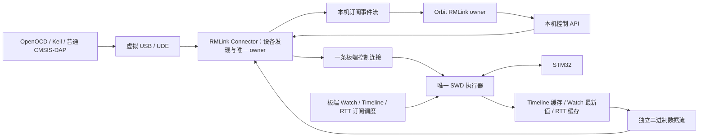

# RMLink 订阅采集与 Orbit 接入完整方案

日期：2026-10-14。本文保留实施前设计基线，不能据此推断当前功能完成度。2026-10-15 已开始 0.2.0 实现，当前代码、验收和设计差异见 [实施记录](subscriptions-implementation.md)。原检查基线为 RMLink `c394931`（固件 0.1.6 / Connector 0.1.4）与 Orbit `3928bbb6f4990ff336dfbe71f745f5f593b12e48`；Orbit 开发在独立工作树，原用户工作区保持原状。

## 1. 产品目标与已确定决策

RMLink 的首要目标是提高 Orbit Timeline 的实际采样率，并使采样节拍不再取决于每次电脑与探针之间的无线往返。Watch、Timeline、RTT 均采用板端订阅：电脑下发任务，ESP32 持续执行，数据批量回传。仅把电脑轮询封装为 subscribe() 不算完成。

用户已确定：

- 后续 SWD 默认请求频率为 **4000 kHz = 4 MHz = 4,000,000 Hz**。固件默认、工具参数、Connector/Orbit 会话默认和 OpenOCD 测试配置需统一；用户显式设置仍优先。第三方软件发来的有效 DAP_SWJ_Clock 按标准执行，不强制改成 4 MHz。
- 标准 CMSIS-DAP 的后续主入口和兼容性验收路径为 **Windows 虚拟 USB**。现有板端 TCP DAP 作为 Connector 的内部传输继续使用；不再将调试软件直接 TCP 接入作为主线。
- 保留原生 USB DAP 能力和有线配网；Orbit 专用通道支持有线与无线，首轮优先实现无线订阅。
- STM32 可以保留测试程序，后续验收默认不恢复旧程序。需要恢复时显式选择；保留原备份和历史证据，测试后记录当前程序身份和运行状态。
- 沿用当前 ESP32-S3、电脑 2.4 GHz 热点和 STM32F103C8。一个目标只有一个控制会话、一套 SWD 内核。
- RMLink 驱动配套组件必须能独立服务第三方前端。设备、目标控制、读取计划、三类订阅、缓存、数据分发和错误恢复作为公开通用能力提供；Orbit 是接入方之一，核心功能不得依赖 Orbit 进程或私有接口。

**历史边界：设计形成时没有改源码、刷写固件或改变运行中的时钟。** 当时启动默认为 1 MHz；0.2.0 已统一请求 4 MHz，完整目标验收待恢复接线后完成。历史测量中的 2 MHz 不应改写为 4 MHz。后续章节中的“当前基础”均指设计形成时的基线。

## 2. 当前基础、缺口与性能口径

| 项目 | 当前证据 | 本方案要补齐 |
| --- | --- | --- |
| SWD 执行 | `swd.c` 固定核执行，USB/TCP 按 transport + session 互斥，Abort 独立接收 | 有界采集作业、截止时间、板端订阅和上下文切换规则 |
| 调度 | Connector `Broker` 按 control/watch/timeline/background 调度整批请求；固件执行队列是 FIFO | 板端采样期限、RTT 配额、控制屏障和独立数据发送 |
| 标准路径 | 原生 USB64，TCP/虚拟 USB512，排队容量 8；OpenOCD 和 pyOCD 已有实板证据 | 4 MHz 全流程回归、Keil 等逐项兼容验收 |
| Orbit | `SessionTargetSelector` 选择唯一 owner；`SessionTargetOwner` 有 readMemoryBatch/startRtt/readRtt；`NativeScheduler` 有优先级 | RMLink owner、订阅生命周期、事件接收与界面消费 |
| 采样 | 没有板端周期采样、批量采样流或板端 RTT 消费 | 三类订阅及其正确性、性能验收 |
| 驱动 | 本机测试签名修补 UDE 已验收相关 Bulk 取消路径 | 正式签名、安装升级、其他系统和软件组合 |

本次沿用已存在的测量，不重新宣称实板验收：

- 2026-10-13 连续 TCP 4 MiB × 5 中位数约 **0.642 MB/s**。
- 2026-10-14 固件 0.1.6，Connector 在线时交替测 1 MiB/4 MiB、各 5 次，中位数分别 **0.7334/0.7258 MB/s**；这是 ESP32 生成数据到电脑的有效回传，不包含 STM32 SWD。
- 历史请求 4 MHz 的 USB 4 KiB 读取中位数约 **66.42 KiB/s**，仍包含主机和 USB 开销。**ESP32 本地执行 SWD 的纯读取上限尚未量测。**
- 当前 4 MHz 仅有只读扫描证据；全流程烧录/调试及实际 SWCLK 波形不能由此推定通过。

原始证据：`artifacts/logs/benchmark-transport.json`、`artifacts/logs/transport-size-comparison-20261014.json`、`artifacts/logs/speed-packets-20261014/512/clocks-usb.json`。前者历史汇总见 [传输测试](transport-benchmark.md)，当前标准路径见 [提速结果](performance-results.md)。

## 3. 总体架构与两种会话模式

**标准模式：** 上位机通过虚拟 USB 使用标准命令；不在其调试会话内部插入隐藏的采样或 RTT 内存操作。这样不会破坏第三方软件对 DP/AP 寄存器状态、TAR 和响应顺序的假设。

**Orbit 增强模式：** Orbit 的一个 RMLink owner 通过 Connector 独占目标，调试控制与三类订阅都属于这个 owner。新建数据 socket 只负责回传，不产生第二个目标 owner，也不允许直接访问 GPIO/SWD。

同一块探针不能同时被外部 Keil/OpenOCD 和 Orbit 增强模式控制。模式切换顺序为：停止订阅 → 数据结束标记 → 清理执行队列 → 释放板端及服务 owner → 新模式取得会话。已有虚拟设备可以保留枚举，但忙碌时不能抢占目标。

## 4. 三类订阅的统一语义

公共生命周期：`create → validate/prepare → start → update/pause/resume → stop → dispose`。配置返回设备接受的实际限制；不悄悄降频。状态含 owner_generation、subscription_id、revision、capture_id、boot_id、target_epoch。

`update` 先校验新配置，再在完整采样帧/RTT 块边界切换 revision。`stop` 返回最后完成序号及统计；缓存可有界排空。`dispose` 才释放资源。时间到期、样本数到期、用户停止、控制暂停、目标异常和网络丢失使用不同原因码。

| 订阅 | ESP32 的工作 | 回传与 Orbit 消费 | 初始策略（待实测调优） |
| --- | --- | --- | --- |
| Timeline | 按计划读取固定地址或有界指针链；记录真实采集时间和跨度 | 所有有效采样及缺口进入录制，UI 单独降帧显示 | 首先验收 10 个 32-bit 变量、1 kHz；随后扫描 100/200/500/1000/2000/5000 Hz |
| Watch | 周期刷新需要的值；与 Timeline 重合时复用同一份采样 | 默认推送最新值/变化值，并报告 age、有效性、心跳 | 默认 10 Hz，可配置；不要求 UI 以采样率刷新 |
| RTT | 周期检查目标 RTT 控制块和 Up 环形缓冲，分块读取并正确提交 RdOff | 保留原始字节、channel、序号和探针读取时间；主机增量解码 | 默认 5 ms 检查、每轮最多 256 B，空闲退避至 20 ms；支持 2 个 Up 通道 |

Watch 的“仅变化时推送”只减少网络与 UI 工作；为了发现变化，板端仍要按订阅周期读取。Timeline 已覆盖的同地址、同宽度、安全 RAM 字段不重复读取；Watch 对它们取最近样本，其刷新率不反过来降低 Timeline 采样率。

Timeline 暂停、停止或删除共享字段时，在计划边界将仍被 Watch 订阅的字段转入 Watch 低频组；Timeline 恢复后重新合并。停止一个订阅不能让其他订阅只剩永不更新的缓存。目标暂停时，这一规则仍用于 Watch 的暂停态刷新。

RTT 下行是显式写请求，不属于周期自动读取；同一 owner 下有界执行。第一版交付要求三种订阅均可独立运行、同时运行与单独停止；指针链和 RTT 不能留成只有名称的接口。

## 5. 地址计划、合并与数据一致性

前端可以提交地址/类型/成员偏移描述，也可以通过通用符号组件解析 ELF/DWARF。读取计划编译、依赖合并、容量检查和执行预算放在 RMLink 服务的通用模块中；SDK 提供相应数据模型，第三方前端不需要复制 Orbit 内部实现。Orbit 可复用自身已有表达式解析，将结果转换为公开描述。通用符号解析按支持范围逐步提供，首版地址接口不依赖 ELF 解析。ESP32 接收受限读取计划，不执行 JavaScript、任意脚本或无限循环的 SWD 程序。

首版边界建议：一个共享内存采集计划、最多 32 个输出字段、计划最多 4 KiB/128 条操作、单个指针链最多 4 层、每次输出最多 1024 B。可有一个 Timeline 采样组及一个 Watch 专属低频组，合计不超过 32 个字段；同地址由计划编译器去重。RTT 是独立类型，最多两个 Up 订阅。所有上限通过能力查询公布。

受限操作：`READ8/16/32`、`READ_BLOCK`、`LOAD_PTR32`、常量偏移、输出字段映射；运行长度和地址算术均检查溢出。依赖图必须无环。先完成静态地址，再增加指针链执行与共享前缀合并。

- 只合并确认无副作用的 RAM/Flash 访问，按目标内存映射及权限切块；默认不自动订阅外设、调试控制寄存器或未知空间。
- 不把 8/16-bit 外设读取自动扩大成 32-bit，不越过映射区域、MEM-AP 自增边界和输出容量。
- 非对齐、浮点、结构体、数组按原始字节描述，由 Orbit 解码；浮点计算不放进采样热路径。
- 每个可独立调度的块显式设置必需的 DP SELECT、AP CSW/TAR；状态缓存只在一个执行块内有效。切换到调试控制、其他采集类型或异常后失效。
- 指针每帧重新解析，空指针/越界/FAULT 使相应字段无效；保留其他成功字段与状态。不把上一帧的值伪装成本帧有效值。
- 多个变量在运行目标上依次读取，不是同一瞬间的原子快照。每帧记录起始时间和采集跨度；需要一致对象快照时，可使用目标序列锁/版本字段协议。无法证明一致时明确标记。
- 指针链读取期间对象可能变化；可选首尾重读关键根指针并标记不一致，不承诺彻底解决目标并发对象生命周期问题。

实时 Timeline 默认运行态采样，暂停后在当前 SWD 小块结束处抢占；尚未完成的帧发布 partial 和有效字段位图，不计入有效完整帧率。Watch 可以读取暂停态值。单步或复位经过控制屏障。目标重新烧录/复位后 target_epoch 改变，旧指针、RTT 描述符和采样计划必须重新校验。

## 6. 板端调度：以 Timeline 采样率为核心

保留一套固定核 SWD 执行器。定时器只通知到期，不在回调/ISR 中执行 SWD、分配缓存或调用 socket。使用探针单调微秒时基；按绝对下一截止时刻推进，避免“读取耗时 + sleep”的累计漂移。ESP-IDF 对定时回调也建议保持短小并将工作交给任务：[ESP Timer 5.1.2](https://docs.espressif.com/projects/esp-idf/en/v5.1.2/esp32s3/api-reference/system/esp_timer.html)。

沿用 control > watch > timeline > background 的请求层级，同时明确区分“用户即时 Watch 操作”和“周期 Watch 订阅”：

1. control（暂停、复位、烧录、停止、Abort）优先；在当前有界操作的安全边界处理。
2. 用户即时 Watch 读取有配额，重复请求合并；不能让 UI 轮询形成无限高优先级队列。
3. Timeline 周期作业预留执行时间，按截止时间调度。
4. 周期 Watch 优先复用 Timeline；独有字段按低频作业执行。
5. RTT/background 在剩余预算内分块执行；连续日志不能无限占住 SWD。

初始准入按实测每帧 P99 成本评估，周期作业总估算占用不超过 70%，给控制和抖动留余量；此数值为可调整设计参数。若不满足，返回 PeriodTooShort/BudgetExceeded 和建议周期，用户选择后再降频。运行时仍可能错过 deadline，必须计数和反馈。

采样/RTT 建议每个 SWD 子块最多 8 words，或到达约 200 µs 的软预算后让出；WAIT/FAULT 需要更短、独立的采集期限和 Abort 检查，不能让一个坏地址沿用标准命令的 1 秒等待来阻塞全部采样。具体预算以本地测量调整，200 µs 不是已证实硬上限。

超过一个周期不集中补采历史帧；推进到下一个有效时隙，增加 deadline_missed，留下序号缺口。这样波形时间轴不会把延迟后的连读伪装成原定均匀采样。

网络发送与 SWD 分离，发送任务只取已完成的记录。保留当前核亲和性作基线；若迁移执行核以减少 Wi-Fi 干扰，必须连同专用 GPIO 初始化绑定一起验证，不能仅修改任务核号。

### 调试与采集的控制屏障

仅串行化函数调用不足以保证 MEM-AP 状态正确。Orbit 增强模式提供 `CONTROL_BEGIN/END`：Begin 等待当前小块结束、暂停三类订阅、清空已失效计划作业，返回屏障完成；之后同 owner 的整段调试操作可以发送标准 DAP。End 使采集缓存的 DP/AP 状态失效，按目标状态决定恢复订阅。

屏障必须覆盖一次完整逻辑操作，不能在一条 TAR 写和随后读之间插入采样。屏障由异常路径 finally 关闭；owner 丢失直接停止。订阅运行期间，未持有屏障的原始 DAP 目标访问拒绝或由受控 API 自动包裹。不能凭猜测恢复第三方客户端的寄存器缓存。

上下文失效是双向的：`CONTROL_BEGIN` 成功后，调试 helper 必须清除自身 DP/AP/CSW/TAR 缓存并重新建立首个操作上下文；`CONTROL_END` 后采集侧同样重建。每个让出执行权的读取块必须完成 posted-read 的结果收集/排空，异常时标记上下文无效，不能把前一作业的返回值交给后一作业。

抢占一律发生在有界小块的安全边界，不等待整帧或整个 RTT 数据块。Timeline 按上文发布 partial；RTT 若尚未确认 RdOff 提交则冻结待提交记录，普通暂停/继续后先重新校验描述符和偏移再处理。复位、烧录或 owner 丢失后禁止旧记录继续提交 RdOff，并报告该尾段完成状态不确定。

## 7. RTT 专门规则

RTT 通过目标 RAM 中的控制块和环形缓冲工作；Up 通道的 WrOff 由目标写，RdOff 由探针写。阻塞/非阻塞模式影响缓冲满时目标是否等待或丢弃；这些由目标程序配置：[SEGGER RTT 说明](https://kb.segger.com/RTT)。

首版由 Orbit 提供 `_SEGGER_RTT` 地址，或在明确允许的 RAM 范围内执行一次有界发现；不能每次订阅轮询全 RAM。设备校验签名、通道数、缓冲地址、SizeOfBuffer、RdOff/WrOff 和目标代次，描述符改变时重新校验。

一次消费事务：预留本地 RTT 缓存 → 读取 WrOff/RdOff → 按环形回绕读取可用字节 → 保留数据和待提交记录 → 写新的 RdOff → 确认完成后发布记录。采集预算可以跨块让出，但不能有另一个 RTT 消费者同时修改 RdOff。

- RdOff 写失败或完成状态未知时，保留待提交记录并暂停该通道；在目标代次未变时重新读取并判定旧/新偏移。不能盲目重放消费、重复发布或静默跳过。
- 缓存不足默认不继续推进 RdOff，反馈 Backpressure；目标端可能因此丢弃日志或在 blocking 模式等待，不能承诺不影响目标。持续压力可显式选择丢弃策略，并统计探针已知的丢弃字节。
- 目标在写入 RTT 前已丢弃的日志通常无法从缓冲本身准确计数；状态使用 target_loss_unknown。验收 fixture 内嵌序号，才能检测端到端丢失。
- 时间戳表示探针读取时间，不冒充日志产生时间。若目标日志自身含时间戳，原样传递并另行映射。
- RTT 是字节流，UTF-8 字符和终端控制序列可能跨块，交给主机增量解码。下行写入同样报告实际写入量，未知完成写入不自动重放。

## 8. 缓存、帧和回传

初版用内部 RAM，先测可用 heap 和连续块再分配，建议总预算 64 KiB：Timeline 48 KiB、RTT 12 KiB、Watch/事件 4 KiB；分配失败明确拒绝配置，公布实际容量。8 MB PSRAM 当前未启用，后续只在收益可测时用于额外积压缓存，不作为首版运行前提。

Timeline 满缓存提供两种显式策略：默认实时模式丢最旧完整帧并发 gap 事件；严格录制模式停止并报告 overflow。Watch 保留最新值；RTT 独立缓存。计数器与最终统计不依赖普通数据队列，队列满后仍能查询。

建议每 4 KiB 或最多 5 ms 聚合发送（先满足者触发），低延迟可缩短聚合时限。控制响应走单独的控制连接；TCP 数据流仍会发生队首等待，隔离 socket 只能避免控制直接排在大块数据之后，不能消除共享无线链路的拥塞。

首版建议使用显式 little-endian 二进制编码，不能直接发送含编译器 padding 的 C struct。逻辑数据批次头建议 32 B，字段包括 magic/version/type/flags、capture_id、revision、first_seq、payload_len、record_count、header_len 和 CRC32；boot_id/target_epoch/通道布局在该流绑定元数据中声明。接收时先限制长度、再分配；协商的 payload 上限建议 16 KiB，实际发送批次通常不超过 4 KiB。CRC 用于诊断帧和存储错误，不提供身份认证。

Timeline 单样本建议 24 B 元数据：seq32、t_start_us64、duration_us32、valid_bitmap32、flags16、data_len16，之后是固定布局数据。seq 表示计划采样时隙，跳号可表示漏采。RTT 使用独立的 channel、byte_seq64、长度和读取时间结构，不伪装成定频变量帧；批次头 first_seq 表示记录序号，不能代替 RTT 字节偏移。

序号契约：start 创建新 capture_id，seq 从 0 开始；RUNNING 中每个计划时隙都增加 seq，实际未执行时形成缺口。显式 pause 期间不产生计划时隙，resume 保留 capture_id 并从下一 seq 继续，另发 pause/resume 时间区间。更新数据布局/周期、重新 start、目标代次变化均产生新 capture_id；旧缓存保留旧标识直至结束标记。uint32 按模 2^32 递增，接收方按单向有序流扩展为 64-bit，只比较跨度小于 2^31 的序号；跨流重连从元数据重新建立起点，不根据大差值猜测丢样。

状态至少包括：scheduled/completed/partial、deadline_missed、ring_dropped、transport_dropped、rtt_committed_bytes、rtt_probe_dropped_bytes、target_loss_unknown、WAIT/FAULT/NO_ACK、buffer_high_water、last_seq、实际周期分布、队列等待与 SWD 执行耗时。分类计数不能互相重复计算。

### 容量预算示例

10 个 32-bit 字段、1 kHz：目标有效数据为 40,000 B/s；按上述 24 B 每帧元数据为约 64,000 B/s，再加批次头和传输开销。48 KiB Timeline 缓存约覆盖 0.77 秒，不能承诺长时间离线录制。此前 16 B 元数据下的 56 KB/s 是简化估算，本方案改用 24 B。

若实际 SWCLK 恰为 4 MHz，按理想成功 SWD 32-bit 事务加当前两个 idle clocks 共约 48 clocks 估计，连续数据上界约为 4,000,000 / 48 × 4 ≈ 333,333 B/s；还未计 TAR、posted-read 排空、WAIT、软件循环和调度。此估计依据 [ARM SWD 参考实现](https://raw.githubusercontent.com/ARM-software/CMSIS-DAP/main/Firmware/Source/SW_DP.c)，不是 RMLink 实测值，离散变量和指针链会更低。

数据率同时受 SWD 作业成本和流发送能力限制。当前 0.7 MB/s 左右的 TCP 表明 10 变量/1 kHz 的网络预算有余量，但能否达到该采样率必须先验证 ESP32 本地的离散读取成本。

## 9. 协议与传输承载

保留现有 `0x80` 状态/配网/诊断语义。建议给订阅扩展预留 CMSIS-DAP 厂商命令 `0x81`，在实现及测试完成前不声明其能力；最终数字及二进制字段在 P1 冻结。

| 命令组 | 建议语义 |
| --- | --- |
| CAPABILITIES / STATUS | 协议主次版本、真实限制、默认/当前请求 SWD 时钟、owner 与订阅统计 |
| PREPARE / COMMIT | 分片上传完整配置，校验后原子安装；未完成上传不改变现有任务 |
| SUBSCRIBE / UPDATE / PAUSE / RESUME / UNSUBSCRIBE | 三种订阅生命周期及 revision |
| READ_BATCH / WRITE_BATCH | 离散操作、实际完成量和逐项错误；写入不会自动重放 |
| CONTROL_BEGIN / END | 同 owner 调试控制屏障 |
| STREAM_BIND / ACK / STATUS | 创建只读数据票据、接收进度及状态；首版 ACK 仅报告消费进度，不承诺落盘或重传；不能申请目标所有权 |
| TIME_SYNC / BENCH_LOCAL | 时基映射与板端限时基准；基准需独占采集预算 |

控制载荷含 request_id、subscription_id、revision、分片偏移/总长/片长。64 B USB 和 512 B 无线逻辑包均可分片；校验总长、覆盖、重叠冲突、过期和整数溢出。完整配置提交前不执行目标访问。

**无线：** 继续一条 3241 控制连接，承载标准 DAP 和厂商控制；新增建议 3244 数据端口，通过控制连接取得一次性随机票据，绑定同 owner_generation/boot_id。连接握手有超时、长度与数量限制，票据不得记录日志。3242 仍是临时吞吐诊断端口，不能兼作产品流。

**有线：** 先以同一套厂商控制及 `STREAM_READ` 有界拉取缓存完成语义闭环；由 Connector 持续取流，Orbit 仍使用订阅。不能往标准 DAP IN 端点插入未请求的样本，否则破坏响应匹配。持续速率需要时再增加独立 vendor Bulk 接口/端点和 USB 描述符验收；此阶段不预先保证 USB 与 Wi-Fi 相同的流性能。

服务未来增加直连 USB transport；这一步当前尚未实现。自动选路只在空闲/新会话时进行，活动会话不能静默从 Wi-Fi 换 USB 并继续未知状态的写入。

现有 MAC 配对只是设备识别，本机 token 只保护本机 API；本次票据用于绑定流和会话，不等于无线加密认证。开发版使用受信任热点；面向公开网络分发前另验收设备密钥配对和认证传输，不将私有协议称为加密协议。

## 10. 通用驱动组件、公开接口与前端接入

### 10.1 产品边界与功能分层

对使用者统一提供“RMLink 驱动与连接组件”安装包：内核虚拟 USB 驱动 + 用户态服务/通用目标引擎 + SDK/诊断工具。大部分通用功能集成到配套服务，前端通过公开接口调用；内核部分聚焦虚拟设备、USB 请求及取消处理。板端仍承担需要摆脱无线逐次往返的实时采样和 RTT 消费。

| 层次 | 集成的职责 | 对前端的意义 |
| --- | --- | --- |
| 内核虚拟 USB | CMSIS-DAP 设备呈现、USB 请求和取消生命周期 | 现有标准软件按原 CMSIS-DAP 接口使用 |
| RMLink 用户态服务与通用目标引擎 | 设备发现/配对/配网、连接/选路/重连、owner/权限/租约、目标控制与读写、计划编译与订阅、缓存/分发/统计/时基映射 | 新前端调用高层 API，不自行实现网络协议、SWD 会话和订阅管理 |
| ESP32 固件 | 唯一 SWD 执行、板端周期调度、RTT 环形消费、采样时间戳和实时缓存 | 实际采样节拍独立于前端请求往返 |
| SDK 与前端 | API 封装、数据模型、应用表达式适配、展示与用户工作流 | Orbit、独立绘图工具、自研 IDE 和自动测试程序共用服务 |

核心不能依赖 VS Code 扩展宿主、Orbit 私有文件或其运行状态。目标描述、内存映射、Flash 算法执行和调试控制逐步纳入可复用的用户态引擎；若提取现有实现，先核对许可证和依赖，再整理为共享模块，避免在每个前端复制一套。

### 10.2 对外能力与版本契约

公开 API 按能力查询启用，分组如下；未完成的组返回 UnsupportedCapability，不宣称已可用。

| API 组 | 提供的高层操作 |
| --- | --- |
| Device | 枚举、设备/固件/协议版本、连接状态、配对/配网、传输选择、能力限制 |
| Session | 获取/释放 owner、租约续期、占用原因、控制屏障、Lost 通知 |
| Target | 目标识别、暂停/继续/复位/单步、寄存器、内存和离散批量读写、断点；按目标能力开放 |
| Flash | 指定目标描述/算法的擦除、烧录、校验、进度和取消；未知完成写入不重放 |
| Subscription | Watch、Timeline、RTT 的 create/update/start/pause/resume/stop/status |
| Stream | 二进制记录、时间戳、序号、有效位、缺口、背压与有界多消费者分发 |
| Diagnostics | 请求/实际频率、延迟分布、吞吐、缓存水位、错误与采集统计、可复现报告 |

协议字段使用固定单位和明确整数宽度，例如 clock_hz、period_us、address、byte_length；订阅数据格式与 Orbit UI 名称解耦，公开为 memory_snapshot、memory_series、rtt_stream。服务公布 API 主次版本及 capability，主版本不兼容时明确拒绝，次版本采用可忽略扩展字段和独立能力位。错误具有稳定机器码、实际完成量和是否可重试的说明。

SDK 计划提供 C/C++ 可调用的稳定 C ABI、Python 和 Node/TypeScript 封装；它们封装同一公开协议，目标控制和采样管理以服务为唯一实现。先提供 Python/Node 示例，随后补齐 C ABI 生命周期、缓冲所有权、异步回调与取消规则。使用本机接口无需安装或启动 Orbit。

第三方前端的最小接入链：枚举设备 → 获取会话 → 查询能力 → 提交地址/类型/周期或 RTT 控制块 → 消费二进制事件 → 停止并释放。SDK 不要求前端掌握 DAP 分包、板端 TCP 帧或 USB/IP 命令。

### 10.3 公开接口与多客户端规则

Connector 继续负责发现、配对、重连、虚拟 USB 和 owner。新增订阅注册表、流接收/校验、状态缓存及有界客户端队列；低频控制继续本机 HTTP，持续数据采用本机二进制 WebSocket 或等价有界流接口，避免 JSON hex 编码所有样本。最终选择在 P1 用已有服务依赖确认。

建议本机接口：`POST /v1/sessions/{id}/subscriptions`、`PATCH/DELETE .../{subId}`、`GET .../{subId}/status` 和会话级 `/stream`。WebSocket 握手沿用 token 认证与 Origin 限制；禁止在 URL 查询参数传长期 token。

连接服务接收一条板端数据流，再按订阅向消费者分发。一个 owner 可以授权多个只读消费者访问已经存在的数据流；旁观者不能创建/修改板端计划、写目标、改变时钟或抢占会话，授权在 owner 失效时撤销。首版可以先限制为单个前端进程内的多个消费者，再验收跨进程授权。UI 窗口和录制器不各自创建物理连接；慢消费者的队列独立，不能无限阻塞其他消费者或执行器。

现有标准软件经虚拟 USB 获得标准 CMSIS-DAP 功能；只有主动接入公开增强 API 的前端才会使用板端订阅。不能声称安装组件后，未经适配的 Keil/OpenOCD 会自动调用 Timeline/RTT 订阅。标准模式中也不能为另一个旁观前端隐式启动 SWD 采集。

### 10.4 Orbit 适配边界

Orbit 增加 `rmlink` owner/连接配置和可选 subscription capability，通过 `SessionTargetSelector` 选择；保留现有 `NativeScheduler` 处理控制与一次性操作。高频采样事件不得重新排入“每个样本一次请求”的调度链。

当前 CMSIS-DAP helper 的调试、Flash 算法和读写实现可作为通用目标引擎的复用对象，扩展点和许可证在编码前聚焦核对。长期高层能力由 RMLink 服务提供，Orbit 负责适配 SessionTargetOwner 和界面。迁移期间若需原始 DAP 控制入口，通过 Connector transport 使用同一个 RMLink 租约，并严格进入控制屏障；不将其作为每个新前端必须重写调试内核的永久要求。不能一边让旧 helper 持有虚拟 USB，一边让新 SDK 申请第二个 API owner。

如果某目标/表达式暂不支持板端计划，只能在同 owner 内显式退回一次性批量访问，并显示实际模式；不能静默再开 J-Link/OpenOCD 或第二条目标连接。标准虚拟 USB 模式保持独立兼容选项，结束增强会话后方可切换。

Timeline 的横轴用探针采集时间。TIME_SYNC 在电脑与探针之间取多次时间对，估计 offset/drift 并附不确定度；无线 RTT 不对称，不能宣称绝对微秒同步。重启产生新 boot_id，不能把重启前后时间戳直接拼接为连续采样。

## 11. 断连、目标异常与恢复

| 事件 | 板端 / 服务行为 | Orbit 行为 |
| --- | --- | --- |
| 用户暂停目标 | 控制屏障暂停周期 Timeline，完成当前小块；Watch 可读暂停态 | 标注暂停区间，不补造样本 |
| 单步 / 复位 / 烧录 | 暂停三类订阅；复位/烧录使目标代次和计划缓存失效 | 重新解析符号、绑定 RTT、显式恢复采集 |
| 数据 socket 丢失、控制连接仍在 | 有界缓存；超过 1 秒或达到缓存策略阈值暂停/停止，报告缺口 | 可重新绑定同一会话的数据流，但不能承诺无损补传 |
| 控制 TCP 断开、owner/租约失效 | 立即使旧 generation 无效，取消采样、停止 RTT 偏移提交、清理待执行操作 | 终止会话；自动发现恢复不等于自动继续旧目标操作 |
| 静默半断连 | 增加板端增强会话心跳租约，建议 5 秒心跳/15 秒超时 | 超时明确 Lost；不无限保留后台采集 |
| WAIT / FAULT / NO_ACK | 有界失败，字段无效或任务停止；必要时重建 DP/AP 状态 | 显示具体错误及实际采样量 |
| 目标程序变化/RTT 描述符无效 | 停止相关订阅，保留诊断，等待重新配置 | 不用旧地址继续读写 |

如果需要重连补传，下一阶段增加带保留窗口的应用级可靠确认；首版进度 ACK 不提供重传。TCP send 成功仅表示数据交给协议栈，不代表 Orbit 已落盘。首版不保证跨断线、跨进程重启的 exactly-once 录制；已知缺口报告范围和原因，异常断电/进程崩溃导致末尾统计丢失时标注“尾部丢失范围未知”，不能虚报精确丢帧数。写请求及 RTT 消费提交的完成状态未知时，禁止自动重放。

## 12. 代码划分与实施顺序

新增模块以下均为拟定名称，按责任拆分，避免复制第二套 SWD 实现。

| 层 | 拟增/改模块 | 责任 |
| --- | --- | --- |
| 固件核心 | `rmlink_target_ops`、现有 `swd.c`/owner 核心 | 有界 MEM-AP 操作、控制屏障、同执行器调度与取消 |
| 固件订阅 | `rmlink_read_plan`、`rmlink_subscriptions`、`rmlink_sampler` | 计划校验、指针依赖、时隙与 Watch/Timeline 去重 |
| 固件 RTT | `rmlink_rtt` | 描述符、环形读取、RdOff 消费事务与异常恢复 |
| 固件传输 | `rmlink_sample_buffer`、`rmlink_stream`、厂商协议扩展 | 分离缓存、二进制帧、票据绑定与流发送 |
| Connector / 通用引擎 | `target`、`read_plan`、`subscriptions`、`stream`、已有 Broker/API/transport | 高层目标控制、计划编译、owner 绑定、控制屏障、数据分发、状态和认证 |
| SDK | Node/TypeScript、Python、C ABI | 公开协议封装、订阅句柄、异步数据消费、取消和 Lost |
| Orbit / 其他前端 | owner / transport、Timeline/Watch/RTT 适配 | 表达式/符号结果转换、共享租约、事件驱动录制及展示 |
| 验证 | fixture、板端基准、主机模型、实板脚本 | 可复现吞吐、正确性和三订阅共存证据 |

| 阶段 | 交付物 | 阶段检查内容（功能门槛与性能目标见下文） |
| --- | --- | --- |
| P0：统一基线 | 4 MHz 默认、标准测试默认虚拟 USB、保留 fixture；更新旧恢复脚本与备份比较逻辑 | 4 MHz 完整烧录/读回/调试/异常；日志清晰区分请求值和测得波形 |
| P1：协议与板端测量 | 公开 API 与扩展协议冻结、能力查询、内存操作与控制屏障、ESP32 本地计时基准 | 连续/离散/指针准备成本，内容校验、WAIT/取消、owner 越权和上下文切换模型；无 Orbit 的客户端可接入 |
| P2：Timeline 纵向闭环 | 静态地址周期采样 → 独立缓存 → TCP 二进制流 → SDK 录制 | 10×32-bit 的 1 kHz 目标测试；100–5000 Hz 梯度；全部缺口可解释；控制可中断 |
| P3：三订阅完成 | Watch 去重/最新值、板端指针链、RTT Up 消费和字节流 | 指针变化/越界、RTT 回绕/背压/未知提交；Watch+Timeline+RTT 同时运行 |
| P4：通用目标引擎与前端集成 | 服务端高层控制/Flash 能力、RMLink owner；三面板订阅、暂停/重配/恢复、板端时间轴 | 独立 SDK 与 Orbit 均使用公开接口；真实变量和 RTT、唯一 owner、烧录前后重新绑定 |
| P5：有线与产品化 | USB 订阅承载、选路、统一安装/升级、正式签名、C ABI、多前端兼容和长稳 | 无 Orbit 的第三方示例、虚拟 CMSIS-DAP 软件矩阵、切换、热点断开/断电、长期运行 |

下一步实施从 P0/P1 开始，以 Timeline 静态采集纵向跑通为第一个可展示结果；首版最终验收必须包含 P3/P4 的全部三类订阅。Windows 驱动和 UI 美化不占用 Timeline 核心验证的前置时间。

阶段门槛分开记录：错误数据、越权、写入盲目重放、失去取消能力等正确性失败阻止后续集成；在一个明确接受的周期下功能正确，允许进入下一阶段开发。若 P2 只有 700 Hz 可持续，不能把 1 kHz 目标勾选完成，需保留未达标问题、分层计时和后续优化项。P4 的功能完成也不能代替性能达标；只有三种订阅实板通过且同条件相对现有 Orbit 的提升已测出，才可称“订阅首版验收完成”。1 kHz、共存下降 ≤5% 和控制时延指标分别报告通过/未通过。

## 13. 验收矩阵与完成标准

统一测试条件：当前 F103C8、固定 fixture/hash、默认请求 4 MHz、相同变量/地址布局，记录 ESP32 固件、服务、Orbit、驱动、RSSI、数据结构和计时边界；历史 2 MHz 只作有标签的对照。

先在 ESP32 本地计时 SWD，计时期间只写本地缓存/校验摘要，结束后回报结果；再增加 TCP 流，最后接入 Orbit。分别测连续 RAM/Flash、1/4/10/20/32 个离散字段、0/1/3 层指针依赖、目标运行/暂停。正确性使用 fixture 的递增序号、模式数据和一致性字段，不只计算速度。

必须新增同条件对照：现有 Orbit 经虚拟 USB 的主机轮询、SDK 板端订阅、Orbit 板端订阅，均使用同一变量布局、4 MHz 和目标运行状态，交替重复至少 5 次。分别报告有效完整帧率和间隔分布；只有增益超过重复测试波动，才宣称提升。工程目标为典型 10 字段场景达到 1 kHz，并争取相对主机轮询至少 2 倍；两个目标分别验收，不能用 TCP 速率或 UI 显示帧率替代。

| 验证类别 | 内容及目标 |
| --- | --- |
| Timeline 吞吐 | 有效完整帧/s、P50/P95/P99 间隔与采集跨度；10 个独立 32-bit 字段、1 kHz 为首轮工程目标，不是承诺值；若未达标必须定位分层成本 |
| 可持续性 | 每配置短测至少 5 次；1 kHz 主目标持续 10 分钟、无未报告缺口/序号错乱/错误数据，再做 1 小时压力 |
| 三订阅共存 | 单独 Timeline 对照 Timeline+Watch+RTT；示例 Watch10Hz、RTT20KB/s；目标有效采样率下降不超过 5%，做不到则按预算公开限制 RTT 或报告瓶颈 |
| 控制响应 | 流满载时停止/暂停/复位 100 次，测主机发起到板端开始/完成；先以板端排队 P99≤1ms、端到端 P95≤100ms 为验证目标，记录超限而不掩盖 |
| 故障与恢复 | 坏地址、WAIT、FAULT、部分完成、Abort、OwnerLost、旧 ticket/revision、数据半包/超长/乱序逻辑、断网、进程退出、目标复位 |
| RTT 正确性 | 内嵌序号/CRC fixture，跨环形边界和多通道；检查重复、丢失、UTF-8 跨块、RdOff 失败及目标模式影响 |
| Watch 正确性 | 与 Timeline 共享字段无重复 SWD，变化/不变化均有时间和 age；仅暂停/停止 Timeline 或删除共享字段后，Watch 仍按配置刷新，暂停态与无效值明确 |
| 标准回归 | 虚拟 USB 的 OpenOCD 烧录/校验/调试、pyOCD 取消与识别；Keil 单独实测，物理 NRST 补线后另验收 |
| 前端独立性 | 不启动 Orbit，独立 Python/Node 客户端通过公开 API 完成设备枚举、控制、三订阅和释放；P4 验证高层控制/Flash，P5 增加 C ABI 示例及兼容性 |
| 多消费者 | owner 授权的只读消费者无法改目标或采样计划；慢消费者不会拖死采集，owner 丢失时所有旧授权失效；标准软件占用时增强接口明确拒绝 |

完成报告分开列：源码实现、主机模型/协议测试、编译、实板功能、实板性能。每阶段保存可回退产物和独立日志目录，不覆盖历史；保留 fixture 时记录其 hash，不再将旧主 Flash 备份当成所有后续读测试的必需预期值。

所有新能力只有在各自功能与异常测试通过后才置能力位。未支持的目标、指针深度、RTT 布局和数据承载须明确拒绝。未来目标支持扩大到 F4/F7/H7 时另核对缓存、内存映射、MEM-AP 和 RTT 一致性，不由 F103 验收直接推定。

## 14. 设计核对入口

- RMLink：`firmware/components/debug_probe/swd.c`、`rmlink_core.c`、`DAP/Config/DAP_config.h`；`host/rmlink_connector/broker.py`；`host/sdk/rmlink-client.mjs`。
- Orbit：`src/ozone-backend/session-target-channel.ts`（唯一 owner 和现有一次性接口）、`native-scheduler.ts`（优先级）、`src/debugadapter.ts`（owner 工厂接线）。本轮未修改 Orbit。
- 已实现协议以 [protocol-v1.md](protocol-v1.md) 为准；本文件的 0x81、3244 和订阅 API 均为新增设计。
- 默认时钟请求按 [CMSIS-DAP DAP_SWJ_Clock](https://arm-software.github.io/CMSIS-DAP/latest/group__DAP__SWJ__Clock.html) 的 Hz 编码；OpenOCD 配置显示为 kHz，测试工具内部统一记录 Hz。

尚待实验决定的参数：板端实际 SWD 上限、最佳作业分块、每种计划的最低可持续周期、可用缓存、流聚合时限、RTT 共存预算、核亲和性收益、USB 专用数据接口的必要性。上述开放参数不影响“3 类板端订阅、Timeline 优先、一个 owner、一套 SWD”的架构决定。
