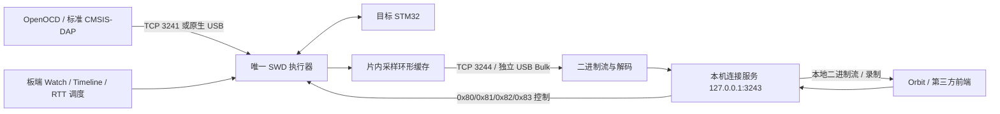

# RMLink 订阅采集与 Orbit 接入设计

> **文档定位说明**：这是 2026-10-14 立项实现 0.2.0 时写下的总体设计方案，主要用来解释“为什么这么分层、控制屏障怎么保证状态一致、三类订阅怎么调度”。此后有两处架构演进：
> 1. 2026-10-19 起无线标准 CMSIS-DAP 改由 OpenOCD 直连 TCP `3241`，不再走虚拟 USB / UDE 驱动（见 [当前项目方向](current-direction.md)）。
> 2. 2026-11-14 起固件采样环固定为 32 KiB 静态片内 RAM（Timeline 16 KiB / Watch 4 KiB / RTT 6 KiB × 2），并新增 `RMS3` 压缩与 `RMS4` 实时流（具体线上字段以 [API v1](api-v1.md) 和 [开发协议 v1](protocol-v1.md) 为准）。

## 1. 设计目标

核心就一件事：**让高频变量采样和 RTT 的节拍不再卡在“电脑请求 → 无线往返 → 板端读一次”上。** Watch、Timeline、RTT 全部由 ESP32 按计划直接在板端周期读取、打包时间戳、批量回传；连接服务（Connector）提供通用 HTTP/二进制流和公开 SDK，Orbit 和第三方前端都通过同一套公开接口接入，不把底层通信绑死在某一个前端进程上。

## 2. 总体分层与唯一控制权

- **标准模式与增强模式互斥**：同一时间只有一个控制 owner。OpenOCD 连上 `3241` 时，增强接口不能抢占；增强会话持有目标时，原始 `/dap` 通路拒绝接入。
- **数据通道无权控目标**：TCP `3244`（或独立 USB Bulk IN）只拿一次性随机票据传采样数据，不能发 SWD 控制命令，也不会产生第二个 owner。

## 3. 三类订阅的职责划分

所有订阅走统一的生命周期：`create -> validate/prepare -> start -> update/pause/resume -> stop -> dispose`。

| 订阅 | ESP32 端行为 | 数据特性 |
| --- | --- | --- |
| **Timeline**（`memory_series`） | 按微秒绝对截止时刻读取固定地址或指针链，记录真实起始时间和跨度 | 来不及执行时跳过当前时隙并递增序号、累计 `deadline_missed`，不补采假波形 |
| **Watch**（`memory_snapshot`） | 周期刷新或与 Timeline 复用同一逻辑字段（同地址/偏移/宽度且样本未过期） | 与 Timeline 重合的字段直接复用最近一次完整样本（不重复打扰 SWD），不反向拖慢 Timeline；Timeline 停掉时自动切回 Watch 自身低频采集 |
| **RTT**（`rtt_stream`） | 按周期检查目标 RAM 中的 `_SEGGER_RTT` 控制块和 Up 环形缓冲，读取后写回 `RdOff` | 原始字节流交由主机增量解码 UTF-8。如果板端发送缓存在满载时阻塞，不再推进 `RdOff`；`RdOff` 写入状态未知时冻结待提交数据，不盲目重读造成日志重复 |

## 4. 地址计划、指针链与一致性边界

- **只执行受限读取计划**：支持 `READ8/16/32`、`READ_BLOCK`、`LOAD_PTR32`（最多 4 层 `offsets`）和常量偏移，不做任意脚本，且依赖图无环。
- **不把多变量读假装成原子快照**：运行中依次读多个地址必然有时间差，因此每帧携带起始时间和 `duration_us`；空指针或越界只让对应字段标为无效，同帧其他字段照常保留。
- **不跨边界合并**：只访问目标声明的安全 RAM/Flash，不跨 MEM-AP 1 KiB 自动递增边界，不把外设 8/16-bit 读悄悄放大成 32-bit 读。
- **芯片变化重绑定**：目标重新烧录或复位导致代次变化时，必须重新校验指针地址和 RTT 控制块，避免读到旧符号地址。

## 5. 板端调度与控制屏障

ESP32 上只有唯一一个固定核上的 SWD 执行器（定时器只发通知，绝不在 ISR 里跑 SWD 或网络）。调度优先级从高到低：

1. **control**：暂停、单步、复位、烧录、停止、Abort。
2. **即时 Watch**：用户显式触发的单次读取（带配额和去重）。
3. **Timeline**：周期采集，按绝对下一截止时刻推进。
4. **周期 Watch**（未与 Timeline 重合的独有字段）。
5. **RTT / background**：在剩余时间片里分块读取，防止海量串口日志把 SWD 彻底占死。

### `CONTROL_BEGIN / END` 屏障

调试软件（或用户点击暂停/读写寄存器/改断点）操作目标时，如果只是函数加锁，中间一旦插进一条采样读，就会破坏 MEM-AP 的 `SELECT / CSW / TAR` 寄存器上下文。因此执行调试控制前必须进入**控制屏障**：

1. 等待当前有界 SWD 小块结束（最多几百微秒安全边界，不等整帧），暂停全部订阅。
2. 使采集侧缓存的 DP/AP 上下文失效，把总线完整交给控制请求。
3. 调试控制完成后，`CONTROL_END` 使控制侧上下文失效，再由采样侧在下一帧重建上下文；若目标处于 Halted 状态，则保持 Timeline 暂停，直到用户点继续运行（`run`）才自动恢复。

## 6. 帧编码、序号契约与异常边界

- **序号与时钟**：每次 `start` 分配新的 `capture_id`，`seq` 从 `0` 单调递增；显式 `pause` 期间不产生时隙，`resume` 沿用同 `capture_id` 续编号。横轴统一使用探针微秒时基，主机可通过 `TIME_SYNC` 估算偏移，但重启后产生新 `boot_id`，不能把重启前后的时间轴强行拼成连续采样。
- **掉线与状态未知**：
  - 仅数据流断开（如无线遮挡）而控制连接健在：允许在同一个 owner 上清理并重开数据流（详见 [API v1](api-v1.md) 的 `realtime` 与 `RMS4`），但不承诺无损补传断流期间的数据；录制遇到真缺口会如实记录或结束，不插值造假。
  - 控制 TCP 断开或租约超时（5 秒心跳 / 15 秒超时）：立即作废旧 `generation`，停止板端采集和 RTT `RdOff` 提交，绝不让孤儿任务在后台无限跑下去。
  - 目标写入或 RTT `RdOff` 完成状态未知时：禁止自动重放。

## 7. 验收原则

设计阶段定下的几条工程边界在后续迭代中一直沿用：
1. **数据对不对优先于跑得快不快**：出现错误数据、越权访问、盲目重放未知写入或失去取消能力，一票否决，必须先修。
2. **分开报告不同口径**：请求周期、实测帧率（含 P50/P95/P99 间隔）、TCP 裸带宽和带 CRC/序号校验的完整录制结果分开统计；单次编译或主机仿真测试通过，不能直接写成实板长稳验收通过。
